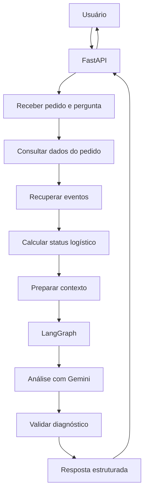

# AI Logistics Investigator Lite

## 1. Objetivo do projeto

Construir uma aplicação capaz de investigar ocorrências logísticas a partir dos dados de um pedido e seus eventos de rastreamento.

O usuário informa um pedido e uma pergunta. A aplicação reúne as informações disponíveis, utiliza um LLM para analisar as evidências e retorna um diagnóstico estruturado, com possíveis causas e recomendações.

O projeto tem dois objetivos:

- Desenvolver uma solução funcional para investigação logística.
- Aprender, na prática, Python, LLMs, LangChain e LangGraph, explorando conceitos de AI Engineering.

## 2. Estado atual do projeto

O projeto já possui um fluxo funcional de investigação, utilizando FastAPI, Python, LangChain e Gemini.

### Funcionalidades implementadas

- API REST desenvolvida com FastAPI.
- Consulta de pedidos armazenados em arquivos JSON.
- Modelagem e validação dos dados com Pydantic.
- Classificação determinística do status logístico.
- Integração com Gemini por meio do LangChain.
- Análise contextualizada dos dados e eventos de rastreamento.
- Resposta estruturada com diagnóstico, causa provável, evidências e recomendação.
- Validação da resposta com modelos Pydantic.
- Testes automatizados das regras de classificação.

### Arquitetura implementada

O fluxo atual funciona da seguinte maneira:

1. FastAPI recebe o identificador do pedido e a pergunta.
2. A aplicação recupera os dados do pedido.
3. Python calcula o status logístico com regras determinísticas.
4. O serviço prepara os dados e eventos para investigação.
5. LangChain envia o contexto ao Gemini.
6. O Gemini produz a análise estruturada.
7. Pydantic valida a resposta.
8. A API retorna o diagnóstico ao usuário.

**Importante:** o status logístico é calculado pelo Python, não pelo LLM. O Gemini é responsável pela análise contextual das evidências e pelas recomendações.

### Próximas evoluções

- Implementar a orquestração da investigação com LangGraph.
- Explorar Tools e Tool Calling.
- Desenvolver cenários adicionais de investigação.
- Melhorar o tratamento de erros e a observabilidade.
- Avaliar persistência de estado e checkpointing.

## 3. Resultado esperado

Ao final, a aplicação deverá permitir:

1. Consultar um pedido pelo identificador.
2. Recuperar os dados e eventos de rastreamento.
3. Receber uma pergunta sobre uma possível ocorrência.
4. Analisar os dados disponíveis utilizando um modelo de linguagem.
5. Identificar possíveis problemas e suas causas.
6. Apresentar as evidências que sustentam a análise.
7. Recomendar possíveis ações.

### Exemplo de utilização

**Entrada:**

- Pedido: `98765`
- Pergunta: "Por que este pedido ainda não foi entregue?"

**Saída esperada:**

- **Diagnóstico:** situação atual do pedido e possível atraso.
- **Causa provável:** hipótese sustentada pelos eventos disponíveis.
- **Evidências:** histórico de movimentações e previsão de entrega.
- **Recomendação:** verificar a situação do pedido com a transportadora.
- **Status:** classificação logística calculada pela aplicação.

A análise deverá se limitar às informações disponíveis. O modelo não deve inventar eventos ou apresentar hipóteses como fatos confirmados.

A aplicação também deverá reconhecer situações em que o pedido esteja seguindo normalmente, sem presumir que sempre existe um problema.

---

## 4. Arquitetura proposta

### Tecnologias

| Tecnologia | Responsabilidade |
|---|---|
| Python | Linguagem principal |
| FastAPI | Exposição das APIs REST |
| Pydantic | Modelagem e validação dos dados |
| LangChain | Integração com modelos de linguagem |
| LangGraph | Orquestração do fluxo de investigação |
| Gemini | Modelo de linguagem (LLM) |
| Pytest | Testes automatizados |
| JSON | Armazenamento inicial dos dados simulados |
| Git/GitHub | Versionamento e portfólio |

### Visão geral da arquitetura planejada



O diagrama representa a arquitetura desejada após a implementação do LangGraph. O fluxo atual já executa as etapas principais, mas ainda não utiliza essa camada de orquestração.

---

## 5. Fluxo funcional da aplicação

### Etapa 1 — Receber a solicitação

A API recebe uma requisição contendo:

- Identificador do pedido na URL.
- Pergunta ou descrição da ocorrência no corpo da requisição.

Exemplo:

```http
POST /orders/98765/investigate
```

```json
{
  "question": "Por que este pedido ainda não foi entregue?"
}
```

### Etapa 2 — Consultar o pedido

A aplicação consulta a fonte de dados e recupera:

- Identificador.
- Status original.
- Data prevista de entrega.
- Eventos de rastreamento.

No MVP, os dados são armazenados em arquivos JSON.

### Etapa 3 — Recuperar eventos de rastreamento

A aplicação recupera o histórico de eventos relacionados ao pedido.

Exemplos:

- Pedido recebido.
- Pedido enviado para transporte.
- Pedido em transferência.
- Última movimentação registrada.
- Pedido entregue.

### Etapa 4 — Calcular o status logístico

O Python aplica regras determinísticas para classificar a situação do pedido.

Classificações atuais:

| Status | Significado |
|---|---|
| `NO_PRAZO` | Pedido dentro do prazo, com mais de 24 horas restantes ou exatamente 24 horas |
| `EM_RISCO` | Menos de 24 horas restantes |
| `ATRASADO` | Prazo de entrega atingido ou ultrapassado, sem confirmação de entrega |
| `ENTREGUE` | Entrega realizada dentro do prazo |
| `ENTREGUE_COM_ATRASO` | Entrega realizada após o prazo |
| `INDETERMINADO` | Informações insuficientes para classificação |

Essa classificação é responsabilidade da aplicação, não do modelo de linguagem.

### Etapa 5 — Preparar o contexto

A aplicação organiza os dados em uma estrutura que será utilizada durante a investigação.

O contexto inclui:

- Identificador do pedido.
- Pergunta do usuário.
- Status original.
- Status calculado.
- Previsão de entrega.
- Eventos de rastreamento.

O objetivo é fornecer ao modelo informações suficientes para analisar a situação sem depender apenas do conhecimento geral do LLM.

### Etapa 6 — Iniciar a investigação com LangGraph

**Planejado — ainda não implementado.**

O LangGraph será responsável por controlar o fluxo de execução.

Inicialmente, teremos os seguintes nós:

1. **Load Order:** carregar os dados do pedido.
2. **Load Events:** recuperar os eventos de rastreamento.
3. **Calculate Status:** executar as regras de classificação.
4. **Analyze Evidence:** analisar as informações com o LLM.
5. **Validate Result:** validar e estruturar o diagnóstico.

### Etapa 7 — Analisar com Gemini

O LangChain será utilizado para integrar a aplicação ao Gemini.

O modelo receberá:

- Dados do pedido.
- Status calculado.
- Eventos de rastreamento.
- Pergunta do usuário.
- Instruções de análise.

O prompt deverá orientar o modelo a:

- Identificar inconsistências.
- Avaliar possíveis causas.
- Utilizar somente as evidências fornecidas.
- Diferenciar fatos de hipóteses.
- Informar quando não houver dados suficientes.
- Apresentar recomendações coerentes.
- Reconhecer quando o fluxo ocorreu normalmente.

### Etapa 8 — Validar o diagnóstico

A resposta será estruturada e validada com Pydantic.

Modelo de resposta:

```json
{
  "diagnostico": "O pedido apresenta atraso na entrega.",
  "causa_provavel": "Não há atualização recente no rastreamento.",
  "evidencias": [
    "Último evento registrado em 04/11/2026.",
    "Previsão de entrega em 04/11/2026."
  ],
  "recomendacao": "Verificar a situação do pedido com a transportadora.",
  "status": "ATRASADO"
}
```

O campo `status` será preenchido pela aplicação com base nas regras de negócio.

### Etapa 9 — Retornar o resultado

A API retorna o diagnóstico ao usuário em formato JSON.

---

## 6. Organização do projeto

Estrutura atual:

```text
ai-logistics-investigator/
│
├── app/
│   ├── __init__.py
│   ├── main.py
│   ├── models.py
│   │
│   ├── ai/
│   │   ├── llm.py
│   │   ├── prompts.py
│   │   └── schemas.py
│   │
│   └── services/
│       ├── investigation_service.py
│       └── order_status.py
│
├── data/
│   └── orders.json
│
├── docs/
│   └── PROJECT_PLAN.md
│
├── tests/
│   └── test_order_status.py
│
├── .env
├── .gitignore
├── README.md
├── requirements.txt
└── requirements-dev.txt
```

A estrutura será ampliada gradualmente, conforme novas responsabilidades forem implementadas.

Não precisamos antecipar arquivos que ainda não serão utilizados.

---

## 7. O que ficará fora do MVP

Para manter o projeto dentro do escopo e concentrar o aprendizado nos conceitos principais, não implementaremos inicialmente:

- RabbitMQ.
- Banco de dados PostgreSQL.
- RAG e bancos vetoriais.
- Arquitetura multiagente.
- Kubernetes.
- Frontend elaborado.
- Integração com transportadoras reais.
- Múltiplos provedores de LLM.

Esses recursos poderão ser avaliados em uma evolução futura.

---

## 8. Critérios de conclusão

Consideraremos o MVP concluído quando:

- [x] A API receber um pedido e uma pergunta.
- [x] Os dados do pedido forem recuperados corretamente.
- [x] Os eventos de rastreamento forem disponibilizados para análise.
- [x] O Gemini realizar uma análise contextualizada.
- [x] O diagnóstico apresentar evidências e recomendações.
- [ ] Respostas sem evidências suficientes forem tratadas adequadamente.
- [x] As regras de classificação do status estiverem implementadas.
- [x] Os principais cenários das regras estiverem cobertos por testes.
- [ ] O LangGraph controlar o fluxo de investigação.
- [ ] Os cenários de investigação estiverem ampliados.
- [ ] O tratamento de erros e a observabilidade estiverem aprimorados.
- [ ] A documentação estiver revisada para apresentação.

---

## 9. Diretrizes de aprendizado

Durante o desenvolvimento:

1. Entenderemos o conceito antes de implementar.
2. Trabalharemos em pequenas etapas.
3. Cada componente terá uma responsabilidade clara.
4. Faremos exercícios e checkpoints de compreensão.
5. Revisaremos decisões arquiteturais e alternativas.
6. Não avançaremos para o próximo assunto sem validar o entendimento atual.

O objetivo não é apenas fazer a aplicação funcionar, mas compreender as tecnologias e as decisões envolvidas na construção de aplicações de IA.

---

## 10. Resultado final

Uma aplicação de investigação logística baseada em LLM e LangGraph, desenvolvida em Python, capaz de analisar dados de pedidos e eventos de rastreamento, apresentar diagnósticos fundamentados em evidências e recomendar ações.

O projeto será documentado, testado e disponibilizado no GitHub como demonstração prática de conhecimentos em desenvolvimento backend e AI Engineering.
