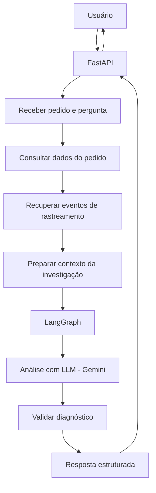

# AI Logistics Investigator Lite

## 1. Objetivo do projeto

Construir uma aplicação capaz de investigar ocorrências logísticas a partir dos dados de um pedido e seus eventos de rastreamento.

O usuário informa um pedido e uma pergunta. A aplicação reúne as informações disponíveis, utiliza um LLM para analisar as evidências e retorna um diagnóstico estruturado, com possíveis causas e recomendações.

O projeto tem dois objetivos:

- Desenvolver uma solução funcional para investigação logística.
- Aprender, na prática, Python, LLMs, LangChain e LangGraph, explorando conceitos de AI Engineering.

## 2. Resultado esperado

Ao final, a aplicação deverá permitir:

1. Consultar um pedido pelo identificador.
2. Recuperar os dados e eventos de rastreamento.
3. Receber uma pergunta sobre uma possível ocorrência.
4. Analisar os dados disponíveis utilizando um modelo de linguagem.
5. Identificar possíveis problemas e suas causas.
6. Apresentar as evidências que sustentam a análise.
7. Recomendar possíveis ações.

### Exemplo de utilização

**Entrada:**

- Pedido: `98765`
- Pergunta: "Por que este pedido ainda não foi entregue?"

**Saída esperada:**

- **Problema identificado:** possível atraso na entrega.
- **Causa provável:** ausência de atualização no rastreamento após a última movimentação.
- **Evidências:** último evento registrado e data prevista de entrega.
- **Recomendação:** verificar a situação do pedido com a transportadora.
- **Status da análise:** possível ocorrência identificada.

A análise deverá se limitar às informações disponíveis. O modelo não deve inventar eventos ou apresentar hipóteses como fatos confirmados.

---

## 3. Arquitetura proposta

### Tecnologias

| Tecnologia | Responsabilidade |
|---|---|
| Python | Linguagem principal |
| FastAPI | Exposição das APIs REST |
| Pydantic | Modelagem e validação dos dados |
| LangChain | Integração com modelos de linguagem |
| LangGraph | Orquestração do fluxo de investigação |
| Gemini | Modelo de linguagem (LLM) |
| Pytest | Testes automatizados |
| JSON | Armazenamento inicial dos dados simulados |
| Git/GitHub | Versionamento e portfólio |

### Visão geral



---

## 4. Fluxo funcional da aplicação

### Etapa 1 — Receber a solicitação

A API recebe uma requisição contendo:

- Identificador do pedido.
- Pergunta ou descrição da ocorrência.

Exemplo:

```json
{
  "order_id": "98765",
  "question": "Por que este pedido ainda não foi entregue?"
}
```

### Etapa 2 — Consultar o pedido

A aplicação consulta a fonte de dados e recupera:

- Identificador.
- Status atual.
- Data prevista de entrega.
- Demais informações relevantes.

No MVP, os dados serão armazenados em arquivos JSON.

### Etapa 3 — Recuperar eventos de rastreamento

A aplicação recupera o histórico de eventos relacionados ao pedido.

Exemplo:

- Pedido recebido.
- Pedido enviado para transporte.
- Pedido em transferência.
- Última movimentação registrada.

### Etapa 4 — Preparar o contexto

A aplicação organiza os dados em uma estrutura que será utilizada durante a investigação.

O objetivo é fornecer ao modelo informações suficientes para analisar a situação sem depender apenas do conhecimento geral do LLM.

### Etapa 5 — Iniciar a investigação com LangGraph

O LangGraph será responsável por controlar o fluxo de execução.

Inicialmente, teremos os seguintes nós:

1. **Load Order:** carregar os dados do pedido.
2. **Load Events:** recuperar os eventos de rastreamento.
3. **Analyze Evidence:** analisar as informações com o LLM.
4. **Validate Result:** validar e estruturar o diagnóstico.

### Etapa 6 — Analisar com Gemini

O LangChain será utilizado para integrar a aplicação ao Gemini.

O modelo receberá:

- Dados do pedido.
- Eventos de rastreamento.
- Pergunta do usuário.
- Instruções de análise.

O prompt deverá orientar o modelo a:

- Identificar inconsistências.
- Avaliar possíveis causas.
- Utilizar somente as evidências fornecidas.
- Informar quando não houver dados suficientes.
- Apresentar recomendações coerentes.

### Etapa 7 — Validar o diagnóstico

A resposta será estruturada e validada com Pydantic.

Formato esperado:

```json
{
  "problem": "Possible delivery delay",
  "probable_cause": "No recent tracking updates",
  "evidence": [
    "Last tracking event occurred before the expected delivery date"
  ],
  "recommendation": "Contact the carrier for an updated status",
  "status": "INVESTIGATION_REQUIRED"
}
```

### Etapa 8 — Retornar o resultado

A API retorna o diagnóstico ao usuário em formato JSON.

---

## 5. Organização prevista do projeto

```text
ai-logistics-investigator/
│
├── app/
│   ├── main.py
│   ├── models.py
│   │
│   ├── api/
│   │   └── routes.py
│   │
│   ├── services/
│   │   ├── order_service.py
│   │   └── investigation_service.py
│   │
│   ├── ai/
│   │   ├── llm.py
│   │   ├── prompts.py
│   │   └── graph.py
│   │
│   └── tools/
│       └── order_tools.py
│
├── data/
│   └── orders.json
│
├── tests/
│   ├── test_orders.py
│   └── test_investigation.py
│
├── .env
├── .gitignore
├── requirements.txt
└── README.md
```

A estrutura será criada gradualmente, conforme cada responsabilidade for implementada. Não precisamos antecipar arquivos que ainda não serão utilizados.

---

## 6. Planejamento de desenvolvimento

**Duração:** 3 semanas  
**Carga horária:** 1 hora por dia, 5 dias por semana  
**Total:** 15 sessões

### Semana 1 — Fundamentos e API

| Sessão | Conteúdo | Resultado |
|---|---|---|
| 1 | Ambiente Python e estrutura do projeto | Ambiente configurado |
| 2 | Classes, type hints e Pydantic | Modelagem dos dados |
| 3 | FastAPI e endpoints REST | API de pedidos funcional |
| 4 | LLMs, prompts e Gemini | Primeira integração com LLM |
| 5 | Integração e testes iniciais | Primeira versão funcional |

### Semana 2 — LangChain e LangGraph

| Sessão | Conteúdo | Resultado |
|---|---|---|
| 6 | LangChain e integração com modelos | Camada de LLM organizada |
| 7 | Tools e Tool Calling | Modelo capaz de utilizar ferramentas |
| 8 | LangGraph: State e Nodes | Estrutura do agente |
| 9 | Edges e Conditional Edges | Fluxo de execução controlado |
| 10 | Integração completa | Investigação funcionando |

### Semana 3 — Qualidade e evolução

| Sessão | Conteúdo | Resultado |
|---|---|---|
| 11 | Cenários de investigação | Diferentes situações logísticas |
| 12 | Pytest | Testes automatizados |
| 13 | Checkpointing e persistência de estado | Entendimento e implementação de estado persistente |
| 14 | Logs e tratamento de erros | Maior confiabilidade |
| 15 | Documentação e revisão | Projeto pronto para apresentação |

---

## 7. O que ficará fora do MVP

Para manter o projeto dentro do prazo e concentrar o aprendizado nos conceitos principais, não implementaremos inicialmente:

- RabbitMQ.
- Banco de dados PostgreSQL.
- RAG e bancos vetoriais.
- Arquitetura multiagente.
- Kubernetes.
- Frontend elaborado.
- Integração com transportadoras reais.

Esses recursos poderão ser avaliados em uma evolução futura.

---

## 8. Critérios de conclusão

Consideraremos o MVP concluído quando:

- [ ] A API receber um pedido e uma pergunta.
- [ ] Os dados do pedido forem recuperados corretamente.
- [ ] Os eventos de rastreamento forem disponibilizados para análise.
- [ ] O Gemini realizar uma análise contextualizada.
- [ ] O LangGraph controlar o fluxo de investigação.
- [ ] O diagnóstico apresentar evidências e recomendações.
- [ ] Respostas sem evidências suficientes forem tratadas adequadamente.
- [ ] Os principais cenários estiverem cobertos por testes.
- [ ] O projeto possuir documentação para execução e apresentação.

## 9. Diretrizes de aprendizado

Durante o desenvolvimento:

1. Entenderemos o conceito antes de implementar.
2. Trabalharemos em pequenas etapas.
3. Cada componente terá uma responsabilidade clara.
4. Faremos exercícios e checkpoints de compreensão.
5. Revisaremos decisões arquiteturais e alternativas.
6. Não avançaremos para o próximo assunto sem validar o entendimento do atual.

O objetivo não é apenas fazer a aplicação funcionar, mas compreender as tecnologias e as decisões envolvidas na construção de aplicações de IA.

---

**Resultado final:** uma aplicação de investigação logística baseada em LLM e LangGraph, desenvolvida em Python, documentada e disponível como projeto de portfólio de AI Engineering.